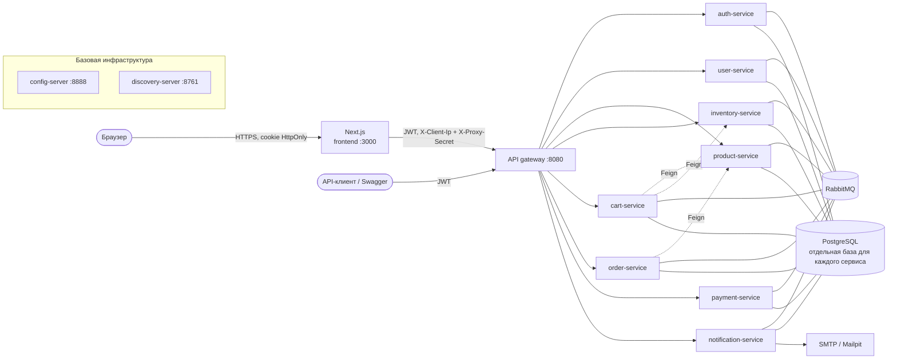
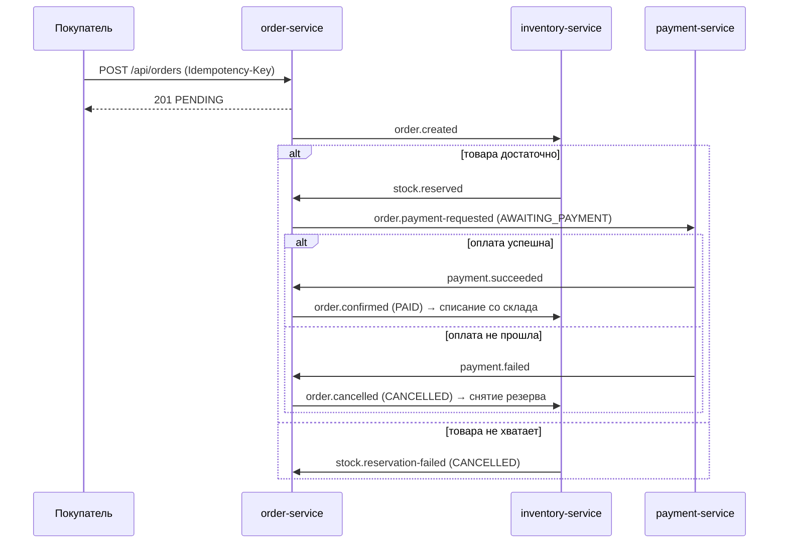
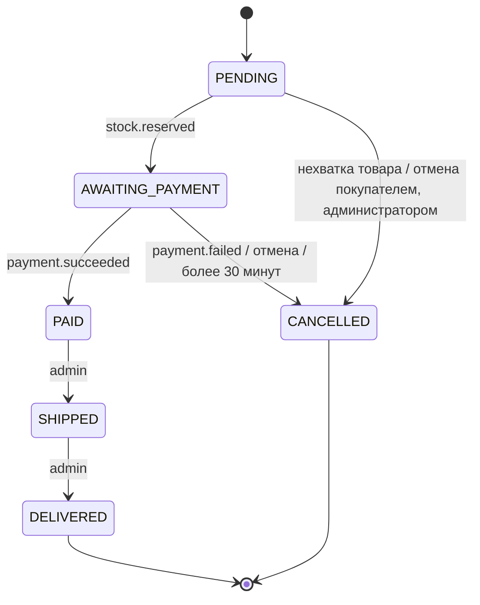

# Архитектура

## Обзор



- Все сервисы читают конфигурацию из **config-server** (`backend/config-server/src/main/resources/config-repo`)
  и регистрируются в **Eureka**. Gateway и Feign-клиенты находят сервисы по имени (`lb://order-service`).
- Порты публикуют только **gateway** и **frontend**. Бизнес-сервисы находятся только во внутренней сети Docker.
- Секреты (пароли баз данных, `JWT_SECRET`, `TRUSTED_PROXY_SECRET`…) всегда берутся из переменных окружения
  и никогда не хранятся в исходном коде или config-repo.
- Локализация: локаль по умолчанию ru-RU — сообщения API и Bean Validation берутся из `messages_ru.properties`
  каждого сервиса и общего `common-messages_ru.properties` в common-lib; фронтенд использует next-intl
  (`messages/ru.json`); часовой пояс Europe/Moscow, валюта RUB, телефоны в формате `+7XXXXXXXXXX`.

## Ответственность и данные

| Сервис | Владеет данными | Примечание |
|---|---|---|
| auth-service | учётные записи, пароли (BCrypt), роли, refresh token | Выпускает JWT; refresh token непрозрачный, хранится в виде хеша, ротируется |
| user-service | профили, адресная книга | Создаёт профиль при получении `user.registered` |
| product-service | категории, товары, изображения | Чтение публичное; запись требует `ROLE_ADMIN` |
| inventory-service | остатки, резервы по заказам, журнал движения | Создаёт запись об остатке при получении `product.created` |
| cart-service | корзины | При каждом чтении пересчитывает цены по каталогу и остаткам |
| order-service | заказы, история статусов, outbox | Управляет жизненным циклом заказа в Saga |
| payment-service | платёжные транзакции, возвраты | Эмулятор платёжного шлюза, можно настроить долю ошибок |
| notification-service | отправленные письма | Автоматическая повторная отправка при сбое SMTP |

У каждого сервиса своя база данных в одном и том же PostgreSQL, со своей ролью, не имеющей доступа к другим базам.
Ни один сервис не читает таблицы другого сервиса: нужные данные получаются через API (Feign) или
приходят в событиях, с сохранением снимка (snapshot) того, что нужно хранить, — например, заказ хранит название
и цену товара на момент оформления.

## Взаимодействие

| Тип | Когда используется | Технология |
|---|---|---|
| Синхронное | Ответ нужен сразу: корзина получает цены и остатки, заказ получает официальную цену | OpenFeign + Resilience4j (timeout, circuit breaker); сбой зависимости возвращает `503`, а не подвешивает запрос |
| Асинхронное | Изменение состояния распространяется на другие сервисы | RabbitMQ topic exchange, у каждой очереди есть DLQ |

Список exchange, routing key и очередей: [common-lib/README](../backend/common-lib/README.md#поток-saga-контракт-событий).

## Saga оформления заказа

Оформление заказа — это транзакция, охватывающая три сервиса. Система использует Saga в стиле **choreography**:
каждый сервис реагирует на события других сервисов, центрального координатора нет. Если какой-то шаг завершается
неудачей, уже выполненные шаги компенсируются (снятие резерва, возврат денег).





Заказ с оплатой при получении (COD) тоже проходит шаг оплаты: payment-service сразу фиксирует
успешную транзакцию, фактически деньги принимаются при доставке.

### Гарантии надёжности

| Проблема | Решение |
|---|---|
| Запись в базу прошла успешно, а отправка события — нет (или наоборот) | **Transactional outbox**: событие записывается в таблицу outbox в той же транзакции, что и бизнес-изменение, а задача отправляет его с publisher confirm (order, inventory, payment) |
| Событие доставлено дважды (RabbitMQ гарантирует at-least-once) | **Идемпотентный** консьюмер: событие пропускается, если у заказа уже есть запись о резерве / платеже, если заказ уже в целевом статусе или если id события уже обработан (notification) |
| Временная ошибка при обработке | 3 повторные попытки, затем сообщение уходит в `<queue>.dlq` для ручной проверки |
| Покупатель дважды нажал «Оформить заказ» или сеть повторно отправила запрос | Заголовок `Idempotency-Key`: тот же ключ возвращает уже созданный заказ |
| Покупатель не оплатил заказ | Задача отменяет заказы `AWAITING_PAYMENT` старше 30 минут (`app.order.payment-timeout`), резерв снимается |
| Заказ отменён во время оплаты | Отмена до прихода запроса на оплату: payment-service ставит отметку и не списывает деньги. Если об отмене стало известно уже после списания: транзакция возвращается |

## Безопасность

```mermaid
sequenceDiagram
    participant B as Браузер
    participant F as Next.js (BFF)
    participant G as Gateway
    participant S as Service
    B->>F: POST /api/auth/login (тот же origin)
    F->>G: POST /api/auth/login
    G->>S: auth-service
    S-->>F: access token (JWT 15 минут) + refresh token (7 дней)
    F-->>B: Set-Cookie shop_at, shop_rt (HttpOnly, SameSite=Lax)
    B->>F: GET /api/orders (cookie)
    F->>G: Authorization: Bearer <JWT>
    G->>G: проверка подписи, срока, iss, token_type; удаление X-User-*
    G->>S: + X-User-Id, X-User-Email, X-User-Roles
    S->>S: повторная проверка JWT, @PreAuthorize
```

- **JWT HS256**, подписывается общим `JWT_SECRET`. Gateway проверяет токен, затем **каждый сервис проверяет его
  повторно** (defense in depth): запрос, попавший во внутреннюю сеть, всё равно не получает прав.
- **Refresh token** — случайная строка, хранится в виде хеша, одноразовая. Повторное использование уже
  ротированного токена считается кражей и отзывает все сеансы учётной записи. Смена пароля или блокировка
  учётной записи также отзывает все сеансы.
- **Браузер не держит токены**: фронтенд работает как Backend-for-Frontend, хранит токены в cookie
  HttpOnly и проверяет Origin для защиты от CSRF. Подробнее: [frontend/README](../frontend/README.md).
- **Gateway**: CORS, rate limit по алгоритму token bucket по адресу клиента (вход/регистрация — 10 раз в минуту),
  circuit breaker для каждого маршрута. См. [api-gateway/README](../backend/api-gateway/README.md).
- **Входные данные**: Bean Validation на каждом запросе; ошибка возвращает `400` со списком неверных полей
  (сообщения на русском).

## Наблюдаемость

- **Correlation id**: заголовок `X-Correlation-Id` генерируется в gateway (если отсутствует), передаётся через HTTP,
  Feign и заголовки RabbitMQ, записывается в каждую строку лога в виде `[service-name,correlationId]` и присутствует
  в каждом `ErrorResponse`. По этому id можно проследить запрос через все сервисы.
- **Health**: `/actuator/health` каждого сервиса (используется Docker Compose для healthcheck);
  фронтенд: `/api/health`.
- **RabbitMQ Management** (http://localhost:15672) для просмотра очередей и DLQ; **Mailpit**
  (http://localhost:8025) для просмотра писем.

## Известные ограничения

| Ограничение | Последствие | Направление развития |
|---|---|---|
| Rate limit хранится в памяти gateway | При нескольких gateway лимит умножается на число экземпляров | Redis (`RequestRateLimiter` из Spring Cloud Gateway) |
| Кеш обновления токенов фронтенда находится внутри процесса | Только один экземпляр фронтенда или sticky session | Распределённая блокировка (Redis) |
| Один PostgreSQL для всех баз данных | Общая точка отказа, хотя данные разделены | Отдельные экземпляры для важных сервисов |
| Эмулятор платёжного шлюза | Реальных денег нет | Заменить `SimulatedPaymentGateway` адаптером провайдера |
| Изображения товаров — внешние URL | Нет загрузки | Объектное хранилище (S3/MinIO) |
