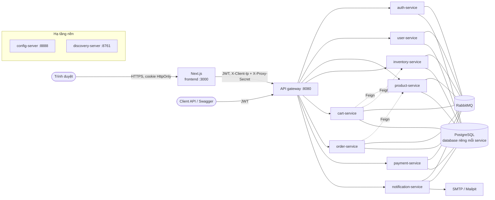
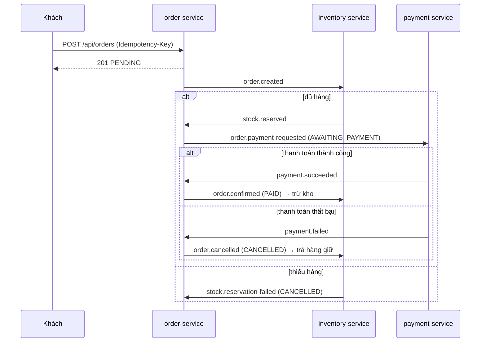
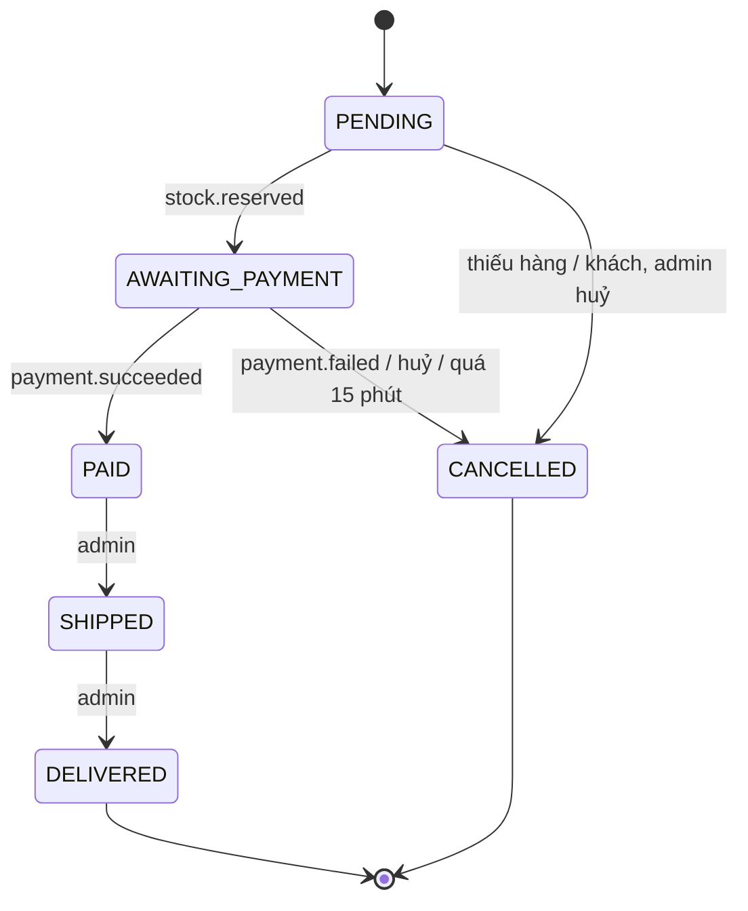

# Kiến trúc

## Tổng quan



- Mọi service đọc cấu hình từ **config-server** (`backend/config-server/src/main/resources/config-repo`)
  và đăng ký với **Eureka**. Gateway và Feign client tìm service theo tên (`lb://order-service`).
- Chỉ **gateway** và **frontend** publish port. Các service nghiệp vụ chỉ nằm trong mạng Docker.
- Secret (mật khẩu database, `JWT_SECRET`, `TRUSTED_PROXY_SECRET`…) luôn đến từ biến môi trường,
  không bao giờ nằm trong mã nguồn hay config-repo.

## Trách nhiệm và dữ liệu

| Service | Sở hữu dữ liệu | Ghi chú |
|---|---|---|
| auth-service | tài khoản, mật khẩu (BCrypt), quyền, refresh token | Phát JWT; refresh token opaque, lưu dạng băm, xoay vòng |
| user-service | hồ sơ, sổ địa chỉ | Tạo hồ sơ khi nhận `user.registered` |
| product-service | danh mục, sản phẩm, ảnh | Đọc công khai; ghi cần `ROLE_ADMIN` |
| inventory-service | tồn kho, giữ hàng theo đơn, sổ biến động | Tạo bản ghi tồn kho khi nhận `product.created` |
| cart-service | giỏ hàng | Định giá lại theo catalogue và tồn kho mỗi lần đọc |
| order-service | đơn hàng, lịch sử trạng thái, outbox | Điều khiển vòng đời đơn trong Saga |
| payment-service | giao dịch thanh toán, hoàn tiền | Cổng thanh toán giả lập, có thể cấu hình tỉ lệ lỗi |
| notification-service | e-mail đã gửi | Gửi lại tự động khi SMTP lỗi |

Mỗi service có database riêng trên cùng một PostgreSQL, với role riêng không truy cập được database
khác. Không service nào đọc bảng của service khác: dữ liệu cần dùng được lấy qua API (Feign) hoặc
nhận qua sự kiện, kèm ảnh chụp (snapshot) những gì cần lưu, ví dụ đơn hàng lưu tên và giá sản phẩm
tại thời điểm đặt.

## Giao tiếp

| Kiểu | Dùng khi | Công nghệ |
|---|---|---|
| Đồng bộ | Cần câu trả lời ngay: giỏ hàng lấy giá và tồn kho, đơn hàng lấy giá chính thức | OpenFeign + Resilience4j (timeout, circuit breaker); lỗi phụ thuộc trả `503` thay vì treo |
| Bất đồng bộ | Thay đổi trạng thái lan sang service khác | RabbitMQ topic exchange, mỗi queue có DLQ |

Danh sách exchange, routing key và queue: [common-lib/README](../backend/common-lib/README.md#luồng-saga-hợp-đồng-sự-kiện).

## Saga đặt hàng

Đặt hàng là một giao dịch trải qua ba service. Hệ thống dùng Saga kiểu **choreography**: mỗi
service phản ứng với sự kiện của service khác, không có bộ điều phối trung tâm. Khi một bước thất
bại, các bước đã làm được bù trừ (trả hàng, hoàn tiền).





Đơn thanh toán khi nhận hàng (COD) cũng đi qua bước thanh toán: payment-service ghi nhận ngay
một giao dịch thành công, tiền thực tế được thu khi giao.

### Đảm bảo tin cậy

| Vấn đề | Cách xử lý |
|---|---|
| Ghi database thành công nhưng gửi sự kiện thất bại (hoặc ngược lại) | **Transactional outbox**: sự kiện được ghi vào bảng outbox trong cùng transaction với thay đổi nghiệp vụ, một job gửi đi với publisher confirm (order, inventory, payment) |
| Một sự kiện được giao hai lần (RabbitMQ đảm bảo at-least-once) | Consumer **idempotent**: bỏ qua khi đơn đã có bản ghi giữ hàng / thanh toán, khi đơn đã ở trạng thái đích, hoặc khi id sự kiện đã được xử lý (notification) |
| Lỗi tạm thời khi xử lý | Thử lại 3 lần, sau đó message vào `<queue>.dlq` để kiểm tra thủ công |
| Khách bấm đặt hàng hai lần, hoặc mạng gửi lại request | Header `Idempotency-Key`: cùng key trả lại đúng đơn đã tạo |
| Khách không thanh toán | Job huỷ đơn `AWAITING_PAYMENT` quá 15 phút (`app.order.payment-timeout`), hàng giữ được trả lại |
| Đơn bị huỷ trong lúc đang thanh toán | Huỷ trước khi yêu cầu thanh toán đến: payment-service ghi dấu và không thu tiền. Thu tiền xong mới biết đơn đã huỷ: giao dịch được hoàn tiền |

## Bảo mật

```mermaid
sequenceDiagram
    participant B as Trình duyệt
    participant F as Next.js (BFF)
    participant G as Gateway
    participant S as Service
    B->>F: POST /api/auth/login (cùng origin)
    F->>G: POST /api/auth/login
    G->>S: auth-service
    S-->>F: access token (JWT 15 phút) + refresh token (7 ngày)
    F-->>B: Set-Cookie shop_at, shop_rt (HttpOnly, SameSite=Lax)
    B->>F: GET /api/orders (cookie)
    F->>G: Authorization: Bearer <JWT>
    G->>G: kiểm tra chữ ký, hạn, iss, token_type; xoá X-User-*
    G->>S: + X-User-Id, X-User-Email, X-User-Roles
    S->>S: kiểm tra lại JWT, @PreAuthorize
```

- **JWT HS256**, ký bằng `JWT_SECRET` chung. Gateway kiểm tra, rồi **mỗi service kiểm tra lại**
  (defense in depth): một request lọt vào mạng nội bộ vẫn không có quyền.
- **Refresh token** là chuỗi ngẫu nhiên, lưu dạng băm, dùng một lần. Dùng lại một token đã xoay
  vòng bị coi là bị đánh cắp và thu hồi mọi phiên của tài khoản. Đổi mật khẩu hoặc khoá tài khoản
  cũng thu hồi mọi phiên.
- **Trình duyệt không cầm token**: frontend là Backend-for-Frontend, giữ token trong cookie
  HttpOnly, kiểm tra Origin để chống CSRF. Chi tiết: [frontend/README](../frontend/README.md).
- **Gateway**: CORS, rate limit token bucket theo địa chỉ client (đăng nhập/đăng ký 10 lần/phút),
  circuit breaker cho từng route. Xem [api-gateway/README](../backend/api-gateway/README.md).
- **Dữ liệu vào**: Bean Validation trên mọi request; lỗi trả `400` kèm danh sách trường sai.

## Quan sát

- **Correlation id**: header `X-Correlation-Id` được sinh ở gateway (nếu thiếu), chuyển qua HTTP,
  Feign và header RabbitMQ, ghi trên mọi dòng log dạng `[service-name,correlationId]` và có trong
  mọi `ErrorResponse`. Một yêu cầu có thể được lần theo qua mọi service bằng id này.
- **Health**: `/actuator/health` của mọi service (Docker Compose dùng cho healthcheck);
  frontend: `/api/health`.
- **RabbitMQ Management** (http://localhost:15672) để xem queue và DLQ; **Mailpit**
  (http://localhost:8025) để xem e-mail.

## Giới hạn đã biết

| Giới hạn | Hệ quả | Hướng mở rộng |
|---|---|---|
| Rate limit lưu trong bộ nhớ gateway | Chạy nhiều gateway thì hạn mức nhân theo số instance | Redis (`RequestRateLimiter` của Spring Cloud Gateway) |
| Bộ nhớ đệm làm mới token của frontend nằm trong tiến trình | Chỉ chạy một instance frontend, hoặc sticky session | Khoá phân tán (Redis) |
| Một PostgreSQL cho mọi database | Một điểm lỗi chung, dù dữ liệu đã tách | Instance riêng cho service quan trọng |
| Cổng thanh toán giả lập | Không có tiền thật | Thay `SimulatedPaymentGateway` bằng adapter của nhà cung cấp |
| Ảnh sản phẩm là URL bên ngoài | Không có upload | Object storage (S3/MinIO) |
